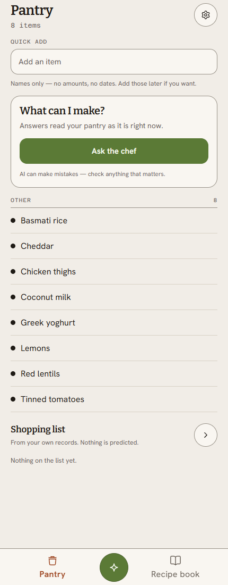

# Pantry

A pantry app. Pantry, shopping list, recipe book, and a chef that drafts a meal from what's
actually in stock.

The subject of the repo is underneath all that. One typed path for data, so transport,
errors, paging, caching and auth are handled once instead of once per screen. If you're
reading to judge the engineering, read `services/shared/` and the ADR. The screens are the
excuse.



## Status

Working end to end: pantry, shopping list, recipe book, settings, sign-in and sign-up. 285
tests, 243 of which run without a database.

Partial: the AI chef. The cost model, the schema, the ledger tables and the three functions
that reserve, settle and release a run are built and tested. The route handler and the seam
that wires them together are not, so the chef screen is a shell.

Not there yet: seed data, shared households, offline mode.

## Running it

Node 22 and a Supabase project.

```bash
npm install
```

Put these in `.env.local` (names only, values from your Supabase project settings):

- `NEXT_PUBLIC_SUPABASE_URL`
- `NEXT_PUBLIC_SUPABASE_PUBLISHABLE_KEY`
- `SUPABASE_SECRET_KEY`
- `SUPABASE_JWKS_URL`
- `SUPABASE_PROJECT_ID`
- `DATABASE_URL`

Then:

```bash
npm run db:migrate     # applies drizzle/0000 to the current head
npm run db:gen-types   # only if you change the schema, needs the Supabase CLI
npm run dev
```

Tests:

```bash
npm test          # no database needed
npm run test:rls  # 42 row-level-security tests, needs DATABASE_URL
```

## The one decision worth reading

Row-level security is the boundary. Application code is not.

Every read goes through a server-side action that has already resolved the session. Cached
reads use a narrow bypass client, and only for tables where the query is scoped by a user id
the server resolved itself. Cache keys are built from that id, never from anything the
browser sent.

Every write is a Postgres function that checks and writes in one statement, so two
concurrent writes cannot both pass a check that was true a moment ago.

The reasoning, and the failure it prevents, is in
[`docs/adr/0001`](docs/adr/0001-trusted-reads-and-server-cache.md).

## Where things live

- `app/` - routes. Thin, a page renders a screen and nothing else.
- `screens/` - the client components behind each route.
- `actions/` - server actions. The only write entry point.
- `hooks/` - React Query hooks, one per domain.
- `services/` - the transport layer. Client factory, interceptors, both Supabase clients.
- `lib/db/` - Drizzle schema and generated types. Migrations are in `drizzle/`.

## Known limits

- One user per account. No households, no sharing.
- No seed script. You start with an empty pantry.
- No AI route. What exists is the ledger underneath it.
- The pet store sandbox at `/sandbox` is a demonstration of the service layer, not a
  feature. It talks to Swagger's public API.

## How it was built

I defined the shapes: the schema, the security model, the write path, the ledger. AI
accelerated the build from there.

The `AGENTS.md` files keep those shapes consistent across sessions. Each domain gets written
down once, so the next pass starts from the same constraints instead of rediscovering and
reinventing them.
